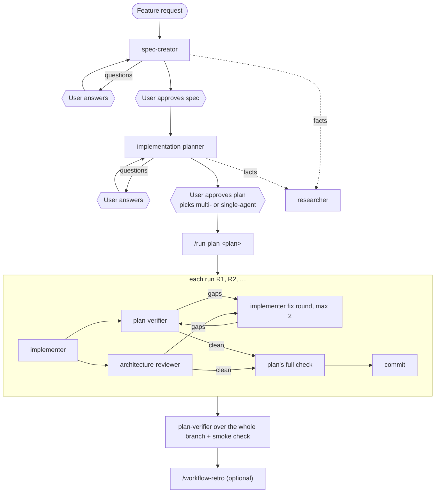

# sdd-engineering

Spec-driven development with Claude Code agents. A feature goes through four gates: a
spec the user approves, a plan the user approves, an implementation done run by run, and
a verification of the code against every item of the plan. Each gate is a separate agent
with its own tools and limits, so the agent that writes code is never the one that judges
it. A retro at the end turns what went wrong into concrete changes to agents and skills.

## Install

```
/plugin install sdd-engineering@devdigest-ai
```

This also installs its dependencies:

| Plugin | Used for |
| :- | :- |
| `engineering-paved-path` `^1.0.0` | Skills the planner assigns to steps and the implementer follows (React, Next.js, Fastify, architecture, testing, security) |
| `research-tools` `^1.0.0` | `researcher`, for cited facts during spec and planning |
| `architecture-review` `^1.0.0` | `architecture-reviewer`, which reviews every run |

Requirements: `git`, and `node` on `PATH` for the hooks. Restart the session (or run
`/reload-plugins`) after installing.

## What's inside

| Component | Kind | Does | Writes |
| :- | :- | :- | :- |
| `sdd-engineering:spec-creator` | agent | Draft spec: problem, goals, user stories, EARS acceptance criteria with ids (`AC-1`…), edge cases, untrusted inputs; reviews design screenshots; works in question rounds | draft specs only (hook-enforced) |
| `sdd-engineering:implementation-planner` | agent | Reviews the approved spec against the code, asks questions, then plans: steps with files, skills, tests and Done-when; runs; verification commands; risks | nothing (returns the plan) |
| `sdd-engineering:implementer` | agent | Executes one run of the plan: code and the tests the plan lists, checks after each step, self-check of its own diff; stops with `BLOCKED` when the plan doesn't fit | code and tests |
| `sdd-engineering:plan-verifier` | agent | Traceability matrix of the diff against every plan item, plus a reverse scan for unplanned changes | nothing |
| `/sdd-engineering:run-plan` | skill | Orchestrates the runs of an approved plan in the main session | commits |
| `/sdd-engineering:workflow-retro` | skill | Retro of a finished workflow from the session transcripts: tokens, agents, order, errors, what each agent missed → proposed changes | the retro file |

## How it works



1. **Spec.** Ask for a spec ("use sdd-engineering:spec-creator to spec <feature>"). The
   agent writes `specs/<slug>.md` (or `<package>/specs/<slug>.md`) with `Status: draft`
   and returns numbered questions. Answer them; the session resumes the agent until no
   `[NEEDS CLARIFICATION]` is left. Only you change the status to `approved`.
2. **Plan.** Ask for a plan for the approved spec. The planner reads the code and the
   project's `CLAUDE.md`, `package.json` and CI, returns questions or recommendations
   first, then the plan. The session saves it to `specs/plans/<slug>.plan.md`. Every plan
   ends with the question: multi-agent (reviewers after each run) or single-agent.
3. **Run.** `/sdd-engineering:run-plan specs/plans/<slug>.plan.md` (or `… R2`, `… all`).
   Per run: implementer → plan-verifier and architecture-reviewer in parallel → up to two
   fix rounds → the plan's full check → one commit. After the last run, plan-verifier
   checks the whole branch and the session runs a smoke check.
4. **Retro.** `/sdd-engineering:workflow-retro` reads this session's transcripts and
   writes `.claude/retros/<date>-<slug>.md` with findings and proposed changes. Nothing
   in agents or skills changes until you pick the proposals.

Any step can be used on its own: a plan for a bug fix needs no spec, and the
verifier can check any plan.

## What the plan must contain

The agents downstream of the planner rely on these sections:

- Header: `Status: ready`, `Branch:`, `Execution: multi-agent | single-agent`.
- `## Steps` — `### S<n> — <title>` with Files, Change, Skills (`engineering-paved-path:*`),
  Tests, Done when, Covers (`AC-n`).
- `## Runs` — which steps each run holds and what it must end green on.
- `## Verification commands` — a quick check per step and a full check per run. Use
  package scripts (`npm test`, `pnpm typecheck`); read-only agents can't run `npx` or
  `./scripts/…`.
- `## Acceptance criteria`, `## Constraints`, `## Out of scope`, `## Risks`
  (`## Contract changes` when an API or schema changes).

## Inputs and defaults

Nothing is hard-coded to one repository. Agents learn the project from its `CLAUDE.md` /
`AGENTS.md`, README, `package.json` scripts and CI config. Paths you can pass explicitly:

| Input | Default |
| :- | :- |
| Spec | `specs/<slug>.md` or `<package>/specs/<slug>.md` |
| Design screenshots | `specs/designs/<slug>/` |
| Plan | `specs/plans/<slug>.plan.md` |
| Retros | `.claude/retros/` |

## Safety

Plugin agents can't carry their own hooks, so `hooks/hooks.json` adds two `PreToolUse`
guards that act only inside the named agents (the main session and the implementer are
not affected):

| Hook | Guards | Blocks |
| :- | :- | :- |
| `readonly-bash.mjs` | spec-creator, implementation-planner, plan-verifier | file writes, redirects, state-changing git, installs, interpreters, `npx`, `./scripts/…` |
| `spec-write-scope.mjs` | spec-creator | any Write/Edit outside `*.md` directly in `specs/` or `<package>/specs/`, READMEs, and changing a spec that isn't `Status: draft` |

The researcher and architecture reviewer have the same Bash guard in their own plugins.

## Versions

See [CHANGELOG.md](CHANGELOG.md). Releases are tagged `sdd-engineering--v<version>`; the
dependency ranges above resolve against the dependencies' own tags.

## Layout

```
sdd-engineering/
├── .claude-plugin/plugin.json      # version, dependencies
├── agents/
│   ├── spec-creator.md
│   ├── implementation-planner.md
│   ├── implementer.md
│   └── plan-verifier.md
├── skills/
│   ├── run-plan/SKILL.md
│   └── workflow-retro/SKILL.md, scripts/collect.mjs
├── hooks/
│   ├── hooks.json
│   ├── readonly-bash.mjs           # identical copies in research-tools and architecture-review
│   └── spec-write-scope.mjs
├── CHANGELOG.md
└── README.md
```

Hook tests are in the repository at `tests/hooks/`.
